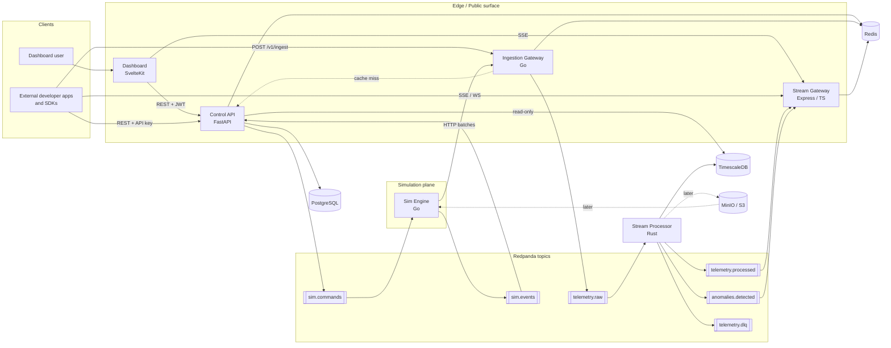

# Mimicron Architecture (v0.1)

> "Twilio for fake telemetry." A multi-tenant platform where developers define scenarios, run virtual device fleets and synthetic traffic, and consume the resulting data through REST, SSE/WebSocket, and (later) webhooks.

`Mimicron` is the project name (API key prefix `mc_live_`, scenario `apiVersion: mimicron/v1`).

## 1. Diagram

See [`architecture.mermaid`](./architecture.mermaid) (renders on GitHub and in Cursor's Mermaid preview). Embedded copy:



## 2. Design principles

1. **Dogfooding.** The simulator sends data through the *public* ingestion gateway exactly as an external device would. Anything an outside developer can do, the simulator does.
2. **Tenant isolation everywhere.** `tenant_id` is derived from credentials server-side, never trusted from request bodies. It is on every row, in every Kafka key, and in every cache key.
3. **At-least-once delivery, idempotent writes.** Duplicates are expected (and later, injected on purpose by chaos). Sinks must tolerate them.
4. **Contract-first.** OpenAPI, JSON Schema, and topic/envelope definitions in `/contracts` are the source of truth. Code follows contracts, not the other way around.
5. **Each datastore justifies itself** by an access pattern (see section 5).

## 3. Services

| Service | Language | Responsibility | Owns |
|---|---|---|---|
| `control-api` | Python / FastAPI | Auth (JWT for humans, API keys for machines), tenants, quotas, scenario CRUD + validation, run lifecycle, telemetry/anomaly **query** API, usage reporting, stream-token minting, internal key-verify endpoint | PostgreSQL |
| `sim-engine` | Go | Parses scenarios; runs device and traffic simulators as goroutine-per-device workers on a deterministic seeded scheduler; emits batches to the ingestion gateway; consumes `sim.commands`; publishes `sim.events` (status + ground-truth labels). Chaos injection and replay hook in here later. | none (stateless; run state lives in memory + `sim.events`) |
| `ingestion-gateway` | Go | `POST /v1/ingest`: authenticate (Redis cache, fallback to control-api), rate-limit (token bucket in Redis), validate envelope, stamp `tenant_id` + `ingest_time`, publish to `telemetry.raw`, increment usage counters | Redis keys |
| `stream-processor` | **Rust** (tokio, rdkafka, sqlx) | Consume `telemetry.raw`; validate/normalize; dedupe; batch-insert into TimescaleDB; run streaming anomaly detectors (EWMA, rolling z-score, stuck-value, dropout); publish `telemetry.processed`, `anomalies.detected`, `telemetry.dlq`; compute traffic rollups | TimescaleDB writes |
| `stream-gateway` | Node / Express / TypeScript | SSE (and later WebSocket) fan-out of `telemetry.processed` and `anomalies.detected`, filtered by tenant + query params; heartbeats; `Last-Event-ID` best-effort resume | none |
| `dashboard` | SvelteKit (TypeScript) | Signup/login, API keys, scenario editor with live validation, run control, live charts, anomaly feed, usage view | none |

**Why these languages (interview answers):** Go for simulation and ingestion (goroutines, low-latency HTTP, easy concurrency). Rust only for the stream processor (predictable memory/latency on the hot path; the one deliberate Rust component). FastAPI/Pydantic for policy-heavy CRUD and scenario validation. Express for the I/O-bound fan-out gateway. SvelteKit for a lean reactive dashboard.

## 4. Key flows

**Run a simulation**
1. User `POST /v1/runs {scenario_id}` on control-api. API validates quotas, snapshots the scenario version, mints a short-lived **run token** (JWT scoped to `tenant_id` + `run_id` + ingest scope), writes `runs` row (`status=pending`).
2. API publishes `start` to `sim.commands` (key = `run_id`).
3. A sim-engine instance consumes it, builds the fleet, and starts emitting HTTP batches to `ingestion-gateway` with the run token.
4. Sim-engine publishes `sim.events` (`run.started`, `run.progress`, `run.completed`, `run.failed`, `ground_truth`). Control-api consumes them and updates `runs` and `ground_truth_labels`.
5. Gateway validates, stamps, and publishes to `telemetry.raw`. Stream-processor persists to Timescale and emits `telemetry.processed` / `anomalies.detected`.
6. Dashboard subscribes via SSE (using a stream token) and also queries history via control-api.

**External developer ingests their own data**: same path from step 5 using an API key with `ingest` scope. No simulation needed.

**Auth model**
- Humans: email/password, JWT access (15 min) + refresh (7 days, rotating). OAuth (GitHub) is a later add.
- Machines: API keys `mc_live_<prefix>_<secret>`; only a SHA-256 hash is stored; shown once. Scopes: `ingest`, `read`, `simulate`, `admin`.
- Run tokens: internal, short-lived JWT for sim-engine to ingest.
- Stream tokens: short-lived (5 min) token from `POST /v1/stream-tokens` because browser `EventSource` cannot send headers.
- Key verification: gateways look up `apikey:{sha256}` in Redis (TTL 5 min). On miss they call `POST /internal/v1/keys/verify` on control-api (network-restricted; shared internal secret) and cache the result. Revocation deletes the cache key.

**Rate limiting and quotas** (per tenant, defined in `quotas` table, enforced in Redis)
- Token bucket on events/sec at the ingestion gateway; request/sec limit on control-api.
- Scenario validation enforces `max_devices`, `max_run_duration`, `max_concurrent_runs`, and minimum emit interval.
- Responses carry `X-RateLimit-Limit`, `X-RateLimit-Remaining`, `Retry-After` on 429.

## 5. Data stores

| Store | Holds | Why |
|---|---|---|
| **PostgreSQL** | Tenants, users, memberships, API keys, quotas, scenarios + versions, runs, ground-truth labels, daily usage | Relational integrity, transactions |
| **TimescaleDB** (separate instance from metadata Postgres) | Telemetry, anomalies, traffic rollups, device registry | Time-series: hypertables, compression, continuous aggregates, retention. Same SQL dialect as Postgres. |
| **Redis** | API-key cache, rate-limit buckets, usage counters (flushed to Postgres), optional last-known device state | Fast ephemeral state |
| **MinIO (S3)** | *Later:* Parquet archives per tenant/run/day; replay sources for time travel | Cheap durable storage |

No Cassandra. If analytics workloads outgrow Timescale later, evaluate ClickHouse and record it in an ADR.

### 5.1 PostgreSQL (control plane), managed by Alembic

```
tenants(id uuid pk, name, slug unique, tier, created_at)
users(id uuid pk, email unique, password_hash, created_at)
memberships(tenant_id fk, user_id fk, role, pk(tenant_id,user_id))
api_keys(id uuid pk, tenant_id fk, name, prefix unique, key_hash unique, scopes text[],
         created_by fk, created_at, last_used_at, expires_at, revoked_at)
quotas(tenant_id pk fk, max_devices, max_events_per_sec, max_concurrent_runs,
       max_run_duration_s, retention_days, max_api_rps)
scenarios(id uuid pk, tenant_id fk, name, description, current_version int, created_at, updated_at)
scenario_versions(id uuid pk, scenario_id fk, version int, spec jsonb, spec_yaml text,
                  checksum, created_at, unique(scenario_id, version))
runs(id uuid pk, tenant_id fk, scenario_version_id fk, status, seed bigint, mode, speed real,
     device_count int, events_emitted bigint default 0, started_at, ended_at, error text, created_at)
ground_truth_labels(id uuid pk, tenant_id, run_id fk, device_id, metric, kind, magnitude,
                    start_time, end_time, source_event text)
usage_daily(tenant_id, day date, events_ingested bigint, events_rejected bigint,
            api_calls bigint, sim_seconds bigint, pk(tenant_id, day))
```
Add Row-Level Security on tenant-owned tables as a defense-in-depth stretch goal (record an ADR).

### 5.2 TimescaleDB (data plane), plain SQL migrations in `db/timescale/`

```sql
-- narrow model: any schema of metrics fits without migrations
CREATE TABLE measurements (
  time        timestamptz NOT NULL,   -- event_time (source clock)
  ingest_time timestamptz NOT NULL,
  tenant_id   uuid        NOT NULL,
  run_id      uuid,
  device_id   text        NOT NULL,
  metric      text        NOT NULL,
  value       double precision NOT NULL,
  PRIMARY KEY (tenant_id, device_id, metric, time)   -- idempotent: ON CONFLICT DO NOTHING
);
SELECT create_hypertable('measurements','time', chunk_time_interval => interval '1 day');
CREATE INDEX ON measurements (tenant_id, run_id, time DESC);
-- compression after 1 day; retention default 7 days (per-tenant overrides handled by a job)
-- continuous aggregates: measurements_1m, measurements_1h (avg, min, max, count)

CREATE TABLE devices (tenant_id uuid, run_id uuid, device_id text, device_type text,
  tags jsonb, first_seen timestamptz, last_seen timestamptz,
  PRIMARY KEY (tenant_id, device_id));

CREATE TABLE anomalies (time timestamptz NOT NULL, tenant_id uuid NOT NULL, run_id uuid,
  device_id text, metric text, detector text, severity text, score double precision,
  value double precision, expected double precision, details jsonb);
SELECT create_hypertable('anomalies','time');

CREATE TABLE traffic_rollups_10s (time timestamptz NOT NULL, tenant_id uuid NOT NULL, run_id uuid,
  flow text, region text, requests bigint, errors bigint,
  p50_ms real, p95_ms real, p99_ms real, bytes bigint);
SELECT create_hypertable('traffic_rollups_10s','time');
```
Control-api uses a **read-only** DB role on this instance and always filters by `tenant_id`.

## 6. Messaging (Redpanda)

| Topic | Key | Producer | Consumer(s) | Notes |
|---|---|---|---|---|
| `sim.commands` | `run_id` | control-api | sim-engine | `start`, `stop`, `pause`, `resume` |
| `sim.events` | `run_id` | sim-engine | control-api | run status + `ground_truth` labels |
| `telemetry.raw` | `{tenant_id}:{device_id}` | ingestion-gateway | stream-processor | 12 partitions in dev; retention 24h |
| `telemetry.processed` | `{tenant_id}:{device_id}` | stream-processor | stream-gateway | normalized events |
| `anomalies.detected` | `{tenant_id}:{device_id}` | stream-processor | stream-gateway | |
| `telemetry.dlq` | `{tenant_id}` | stream-processor | (ops / replay tool) | includes error reason header |

Delivery is at-least-once. Consumers commit offsets only after a successful sink flush. Headers on every message: `tenant_id`, `schema_version`, W3C `traceparent`.

### Event envelope (v1), JSON on the wire (protobuf later if justified by ADR)

```json
{
  "schema_version": 1,
  "event_id": "018f...uuidv7",
  "kind": "telemetry",
  "tenant_id": "uuid (set by gateway, never client-supplied)",
  "run_id": "uuid | null",
  "device_id": "therm-1-0007",
  "device_type": "thermostat",
  "event_time": "2026-07-01T14:03:11.250Z",
  "ingest_time": "2026-07-01T14:03:11.301Z (set by gateway)",
  "seq": 1234,
  "tags": { "site": "hq", "floor": "1" },
  "data": { "temperature_c": 21.4, "humidity_pct": 44.8 }
}
```
- `kind: "telemetry"`: `data` maps metric name to number (booleans as 0/1).
- `kind: "traffic"`: `data` = `{session_id, client_id, method, path, status, latency_ms, bytes, region}`.
- `event_id` is the dedupe key. `seq` is per-device monotonic (lets consumers detect gaps/out-of-order).

## 7. Anomaly detection (stream-processor, v1)

Per `(tenant, device, metric)` state, bounded LRU in memory:
- **EWMA + z-score** (spike/drift), configurable alpha and threshold
- **Stuck value** (N identical readings)
- **Dropout** (no event for k x expected interval; needs the expected interval learned from median inter-arrival)
Detectors are a Rust trait (`Detector`), so new ones are easy to add. Ground-truth labels from the simulator allow computing precision/recall per run (a good dashboard feature and a good portfolio story).

## 8. Observability and ops (milestone M8)

- OpenTelemetry traces propagated via HTTP headers and Kafka headers across all services
- Prometheus metrics per service (RED metrics + queue lag), Grafana dashboards, Loki optional
- `/healthz` (liveness) and `/readyz` (dependencies) on every service
- Terraform for a single-VM deploy first; GitOps/Kubernetes is an explicit later stage

## 9. Later features (design hooks already in place)

- **Chaos/fault injection**: implemented in `sim-engine/internal/chaos` as an emitter middleware (drop, duplicate, delay, reorder, clock skew, schema drift, corrupt). Scenario schema already reserves `spec.chaos`.
- **Time travel / replay**: stream-processor archives Parquet to S3; sim-engine gets a `replay` source that reads archives at 1x to Nx speed. Scenario `spec.time.mode` already supports `accelerated` and `backfill`.
- **Reference app**: e.g., an anomaly-detection monitoring app consuming only the public API/SDK, in `/examples`.
- **Webhooks**, MQTT/WebSocket device protocols, Python/TS SDKs.
